[](https://github.com/jeannicbeaulieu/tika/actions/workflows/tache2.yml)

## 1. Choix de la classe

### 1.1 org.apache.tika.config.TikaExtras

| Élément | Valeur |
|---|---|
| Classe | `org.apache.tika.config.TikaExtras` |
| Test existant | `TikaExtrasTest` (5 tests, tous réussis) |
| Couverture JaCoCo des instructions | 81 % (44/238 manquant) |
| Couverture JaCoCo des branches | 89 % (3/28 manquant) |
| Lignes non couvertes (rouge) | 82, 83, 87, 91, 116, 117, 162, 163, 164 |
| Lignes partiellement couvertes (jaune) | 86, 90, 122, 157 |

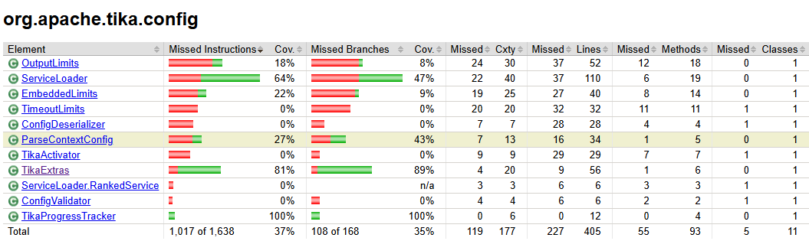
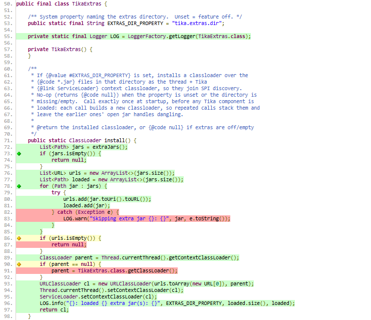
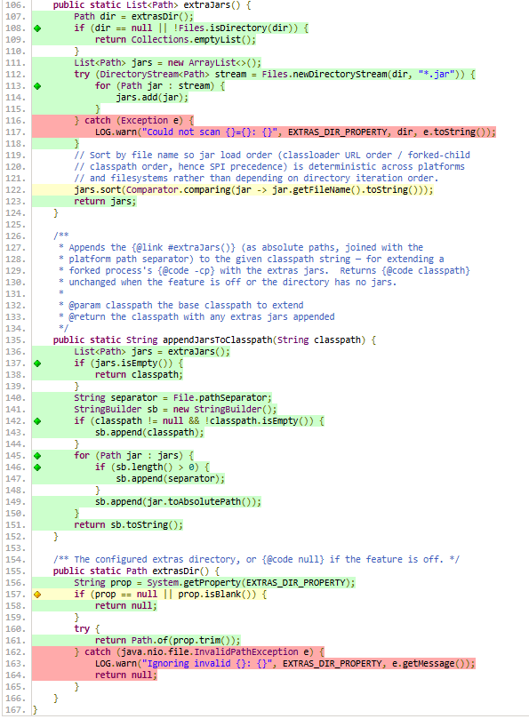


**Justification** Classe courte, sans dépendance lourde, logique claire (conditions, tri, construction
d'un classpath), avec un test existant mais incomplet.

**Preuve de mutants vivants (mesure A).** Pitest, avec uniquement `TikaExtrasTest` :

| Mutants générés | Tués | Score de mutation | Sans couverture | Force des tests |
|---|---|---|---|---|
| 21 | 17 | 81 % | 1 | 85 % |

Couverture de ligne (classes mutées) : 48/58 (83 %). Rapport archivé : `docs/pit-A/`.

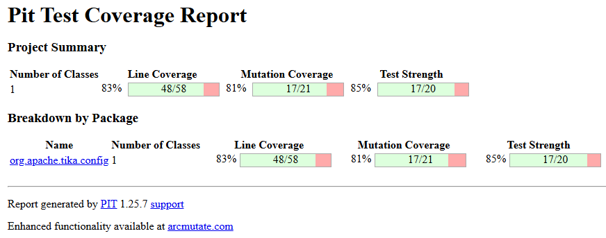
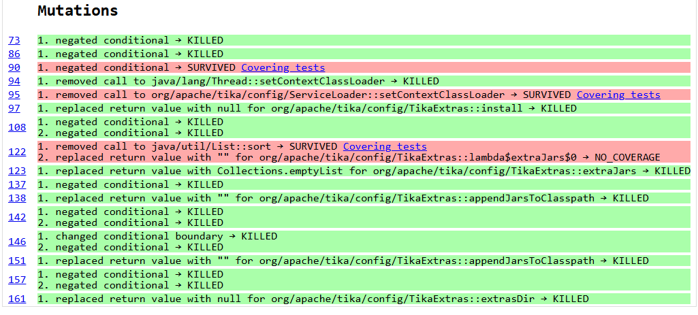

Mutants vivants (4) :

| Ligne | Mutant | Statut | Pourquoi les tests d'origine ne le détectent pas |
|---|---|---|---|
| 90 | negated conditional (`if (parent == null)`) | SURVIVED | le test fournit un classloader déjà non nul, et le classloader de remplacement est le même objet dans l'environnement de test |
| 95 | removed call to `ServiceLoader::setContextClassLoader` | SURVIVED | le test vérifie le classloader du thread, pas celui de `ServiceLoader` |
| 122 | removed call to `List::sort` | SURVIVED | tous les tests utilisent un seul jar, le tri n'a aucun effet visible |
| 122 | replaced return value with `""` pour `lambda$extraJars$0` | NO_COVERAGE | le comparateur n'est appelé qu'avec au moins deux jars |

Remarque : les lignes rouges 82-83, 116-117 et 162-164 (blocs `catch`) comptent pour la couverture JaCoCo mais
ne produisent aucun mutant vivant : Pitest ignore par défaut les appels aux bibliothèques de log.

---

### 1.2 org.apache.tika.mime.Patterns

| Élément | Valeur |
|---|---|
| Classe | `org.apache.tika.mime.Patterns` |
| Test existant | `PatternsTest` (tests réussis) |
| Couverture JaCoCo des instructions | 83 % (63/388 manquant) |
| Couverture JaCoCo des branches | 65 % (22/64 manquant) |

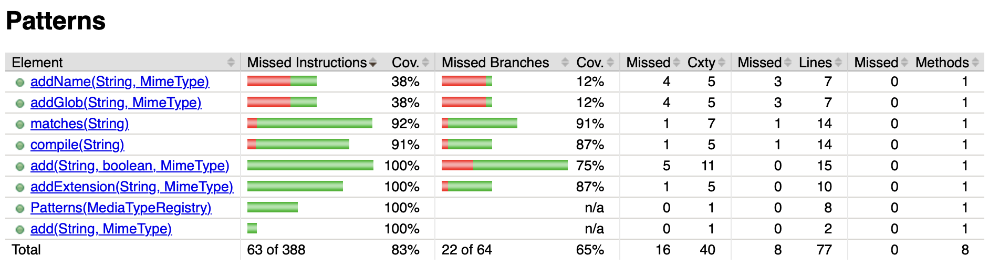

**Justification** Classe de taille raisonnable avec une logique de routage interne (`add()` dispatche vers `addName`, `addExtension` ou `addGlob`) et une compilation glob-vers-regex. Les tests existants vérifient `matches()` sur quelques cas mais ignorent le routage interne et les conditions de remplacement, laissant de nombreux mutants vivants.

**Preuve de mutants vivants (mesure A).** Pitest, avec uniquement `PatternsTest` :

| Mutants générés | Tués | Score de mutation | Force des tests |
|---|---|---|---|
| 44 | 12 | 27 % | 41 % |

Couverture de ligne (classes mutées) : 74 % (57/77).

Mutants vivants (17 SURVIVED) — les plus significatifs :

| Ligne | Mutant | Statut | Pourquoi les tests d'origine ne le détectent pas |
|---|---|---|---|
| 71, 83 | removed call to `addGlob` | SURVIVED | `testAdd()` ne vérifie pas `matches()` après ajout d'un glob complexe |
| 74, 75 | negated conditional (routage vers `addExtension`) | SURVIVED | les tests ne vérifient pas l'effet du routage sur `matches()` |
| 80 | removed call to `addExtension` | SURVIVED | idem — pas de vérification du résultat observable |
| 90, 102, 108, 117 | negated conditional dans `add()` / `addName()` | SURVIVED | aucun test ne tente d'ajouter deux types pour le même motif |
| 173, 175, 177, 179, 187 | negated conditional / replaced return in `compile()` | SURVIVED | `testAdd()` n'exerce pas la compilation glob-vers-regex |

> Le rapport Pitest complet (mesures A, B et C) et les captures des mutants vivants sont présentés à la **section 3.2**.

---

### 1.3 org.apache.tika.sax.BasicContentHandlerFactory

| Élément | Valeur |
|---|---|
| Classe | `org.apache.tika.sax.BasicContentHandlerFactory` |
| Test existant | `BasicContentHandlerFactoryTest` (5 tests : testBody, testText, testHTML, testXML, testIgnore) |
| Couverture JaCoCo des instructions | 50 % (227/459 manquant) |
| Couverture JaCoCo des branches | 38 % (39/63 manquant) |

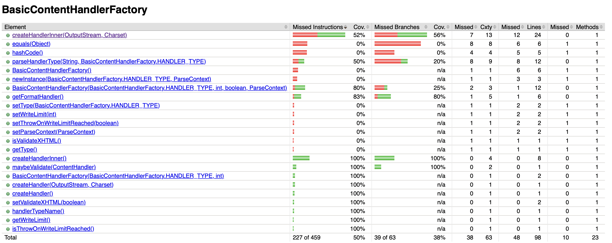

**Justification** La classe encapsule la création de handlers SAX avec une limite d'écriture (`writeLimit`). Les tests existants couvrent les types de handlers mais n'exercent pas la condition frontière `writeLimit < 0`, laissant des mutants vivants sur cette ligne.

**Preuve de mutants vivants (mesure A).** Pitest avec `BasicContentHandlerFactoryTest` uniquement :

| Mutants générés | Tués | Score de mutation | Force des tests |
|---|---|---|---|
| 73 | 23 | 32 % | 96 % |

Couverture de ligne (classes mutées) : 40 % (39/98).

Mutant vivant significatif :

| Ligne | Mutant | Statut | Pourquoi les tests d'origine ne le détectent pas |
|---|---|---|---|
| 171 | changed conditional boundary (`writeLimit < 0` → `<= 0`) | SURVIVED | les tests utilisent `writeLimit = -1` (illimité) ou `writeLimit > 0` (limité) ; la valeur frontière `0` n'est jamais testée |

> Le rapport Pitest complet (mesures A, B et C) et la capture des mutants vivants sont présentés à la **section 3.3**.

---

**Justification du choix des classes.** Les classes `org.apache.tika.mime.Patterns` et `org.apache.tika.sax.BasicContentHandlerFactory` ont été sélectionnées parce que leurs tests existants ne couvrent pas suffisamment le code et ne détectent pas toutes les mutations. Pour Patterns, la couverture initiale des instructions est de 83 %, la couverture des branches est de 65 % et PIT rapporte 12 mutants tués sur 44, soit un score de mutation de 27 %. Pour BasicContentHandlerFactory, la couverture des instructions est de 50 %, celle des branches est de 38 % et PIT rapporte 23 mutants tués sur 73, soit un score de mutation d'environ 32 %. Ces résultats montrent qu'il reste des possibilités d'amélioration des tests.

---

## 2. Génération des tests

### 2.0 Installation et configuration de ChatUniTest

**Environnement**

| Élément | Version |
|---|---|
| ChatUniTest | `io.github.zju-aces-ise:chatunitest-maven-plugin:2.1.1` |
| Modèle local | `codeqwen:v1.5-chat` via Ollama (`http://localhost:11434`) |
| Maven | wrapper `mvnw` du projet |

**Configuration dans `tika-core/pom.xml`**

```xml
<plugin>
  <groupId>io.github.zju-aces-ise</groupId>
  <artifactId>chatunitest-maven-plugin</artifactId>
  <version>2.1.1</version>
  <configuration>
    <apiKeys>xxx</apiKeys>                                        <!-- ignorée par Ollama -->
    <model>codeqwen:v1.5-chat</model>
    <url>http://localhost:11434/v1/chat/completions</url>         <!-- API compatible OpenAI d'Ollama -->
    <testNumber>3</testNumber>
    <maxRounds>5</maxRounds>
    <thread>false</thread>
    <tmpOutput>${project.build.directory}/chatunitest-info</tmpOutput>
    <testOutput>${project.basedir}/chatunitest</testOutput>
  </configuration>
</plugin>
```

**Commande utilisée** (une par classe) :

```bash
mvn chatunitest:class -DselectClass=org.apache.tika.config.TikaExtras
```

Remplacer `-DselectClass` par `org.apache.tika.mime.Patterns` ou `org.apache.tika.sax.BasicContentHandlerFactory` pour les autres classes.

**Sorties** : les fichiers générés sont déposés dans `tika-core/chatunitest/tika-parent/tika-core/org/apache/tika/`. ChatUniTest n'est pas exécuté dans la GitHub Action — les tests générés (corrigés) sont commités directement dans `src/test/java/`.

---

### 2.1 TikaExtras — Exécution sans intervention manuelle

Les deux classes de test (sans la Suite) ont été copiées telles quelles dans
`tika-core/src/test/java/org/apache/tika/config/`.

- **Avec checkstyle activé**, le build s'arrête à la phase `validate` : 31 violations lors de la première
  exécution. Lors d'une seconde exécution, sans modification de notre part, il n'en restait que 8, toutes de la
  même règle (imports avec `.*` interdits, 4 par fichier). Hypothèse : Spotless, exécuté par le build de Tika,
  a corrigé automatiquement l'en-tête, l'ordre et les imports inutilisés.
  Les tests ne passent donc pas sans intervention.
- **Avec checkstyle désactivé** (`-Dcheckstyle.skip=true`), les deux fichiers compilent et 5 tests s'exécutent :

| Fichier | Tests | Réussis | Erreurs |
|---|---|---|---|
| `TikaExtras_extrasDir_3_1_Test` | 1 | 1 | 0 |
| `TikaExtras_appendJarsToClasspath_2_1_Test` | 4 | 0 | 4 |

### 2.2 TikaExtras — Explication et critique des tests générés

**`TikaExtras_extrasDir_3_1_Test`.** Ce fichier contient un seul test. Il définit la propriété `tika.extras.dir` 
à `"   "` et vérifie avec `assertNull` que `extrasDir()` renvoie `null`.

Le test a de bons côtés. Il vise un cas que `TikaExtrasTest` ne vérifie pas, soit une propriété définie mais blanche, 
à la ligne 157. Son oracle est précis : sans la condition `isBlank()`, `Path.of("")` renverrait un chemin vide au lieu 
de `null`, et le test échouerait. Le nom est explicite et la structure Arrange, Act, Assert se lit facilement.

Il a aussi plusieurs défauts. La propriété système n'est jamais remise dans son état d'origine, ce qui peut perturber 
les autres tests. Le test passe par la réflexion pour construire un objet à constructeur privé, alors que la méthode 
est statique et s'appelle directement. Il utilise `@ExtendWith(MockitoExtension.class)` sans aucun mock, et ses imports 
utilisent la forme `*`, ce que checkstyle refuse. Enfin, il ne teste qu'un cas, et le chemin invalide des lignes 162 à 164 reste sans test.

**`TikaExtras_appendJarsToClasspath_2_1_Test`.** Ce fichier contient quatre tests, tous en erreur. L'intention est raisonnable, puisqu'il 
veut tester l'absence de jar, la présence de jars et une erreur pendant la résolution d'un jar. Le problème est que les tests vérifient des 
mocks et non le code de `TikaExtras` :

- Ils simulent des méthodes statiques du JDK, `Files.isDirectory` et `Files.newDirectoryStream`, sans passer par `mockStatic`, ce qui provoque une `NullPointerException` dès la préparation du test.
- Ils créent un mock de la classe testée, qui n'a que des méthodes statiques. L'instance passée à `invoke` est donc ignorée et le mock ne sert à rien.
- Deux tests répètent ce que `appendJarsToClasspathOffReturnsInput` vérifie déjà dans `TikaExtrasTest`.

### 2.3 TikaExtras — Comparaison des oracles

| Critère | Tests originaux (`TikaExtrasTest`) | Tests générés |
|---|---|---|
| Valeurs vérifiées | chaînes exactes (`"base" + sep + abs`), `assertSame` sur l'objet | une valeur (`assertNull`), ou chaînes inventées |
| Données de test | vrais jars créés dans un `@TempDir` | mocks de `Path`, de `Files`, de la classe testée |
| Portabilité | `File.pathSeparator`, fermeture du `URLClassLoader` pour Windows | `/` codé en dur |
| Nettoyage de l'état global | `finally` qui restaure propriété et classloader | aucun |
| Ce qui est testé | le code réel de `TikaExtras` | surtout les mocks eux-mêmes |

---

### 2.4 Patterns — Exécution sans intervention manuelle

Les fichiers générés (sans la Suite) ont été copiés dans `tika-core/src/test/java/org/apache/tika/mime/`.

| Fichier | Tests | Réussis | Erreurs avant correction |
|---|---|---|---|
| `Patterns_add_1_0_Test` | 3 | 0 | 3 |
| `Patterns_matches_5_2_Test` | 4 | 4 | 0 |

3 corrections manuelles nécessaires avant compilation et exécution réussies.

### 2.5 Patterns — Corrections apportées

**Cause commune.** ChatUniTest n'a pas analysé la logique de routage de `add()`. Il a supposé que les entrées se mappent directement à la méthode testée, sans tracer le dispatch interne.

| Test | Erreur | Correction |
|---|---|---|
| `testAddName` | `assertEquals(type2, ...)` — `addName` est un no-op quand `type2` est une spécialisation de `type1` (la branche `isSpecializationOf(type, previous)` ne remplace pas) ; `type1` reste | `assertEquals(type2, ...)` → `assertEquals(type1, ...)` |
| `testAddExtension` | Pattern `"txt"` sans wildcard → route vers `addName`, jamais vers `addExtension` ; clé `"txt"` incorrecte (la méthode stocke `".txt"`) ; assertions contradictoires sur la même clé | Pattern → `"*.txt"`, clé → `".txt"`, `assertNull` contradictoire → vérification d'une clé absente (`".html"`) |
| `testAddGlob` | Pattern `"*.txt"` avec `isJavaRegex=false` → route vers `addExtension`, jamais vers globs ; assertions contradictoires | `isJavaRegex` → `true` pour forcer le stockage direct dans globs ; correction de l'`assertNull` contradictoire |

**`Patterns_matches_5_2_Test`.** Ce fichier contient 4 tests, tous passés sans correction. Il injecte l'état interne (`names`, `extensions`, `globs`, `minExtensionLength`, `maxExtensionLength`) par réflexion, avec des mocks Mockito pour `MimeType` et `MediaTypeRegistry`.

Les tests ont plusieurs défauts. `testMatchesGlobMatch` est une copie exacte de `testMatchesExtensionMatch` (mêmes entrées, même oracle) — il ne teste pas le chemin des globs : les clés `"glob1"` et `"glob2"` injectées dans la map ne correspondent pas à `"name1.ext1"` comme regex Java, donc la boucle ne les atteint jamais. Le stub `when(mimeType1.getName()).thenReturn("name1")` est inutile, car `matches()` n'appelle pas `getName()`. Enfin, la dépendance à la réflexion sur les noms de champs privés rend les tests fragiles à un renommage interne.

Ces tests ne tuent aucun mutant supplémentaire par rapport à mesure A, car ils n'exercent que les branches de correspondance déjà couvertes par `PatternsTest`.

### 2.6 Patterns — Comparaison des oracles

| Critère | Tests originaux (`PatternsTest`) | Tests générés |
|---|---|---|
| Pertinence | Testent le résultat de `matches()` après `add()` | Testent uniquement l'état interne des maps par réflexion |
| Spécificité | Vérifient le type MIME retourné pour un nom de fichier précis | Vérifient la présence d'une clé dans une map — sans vérifier l'effet observable |
| Robustesse | Indépendants de l'implémentation interne | Dépendent de la structure interne (noms de champs) |
| Compréhension du routage | Correcte | Absente — l'IA ne trace pas le dispatch de `add()` |
| Cas limites | Couverts partiellement | Absents (aucun cas null, aucun remplacement de type) |

---

### 2.7 BasicContentHandlerFactory — Exécution sans intervention manuelle

Les fichiers générés (sans la Suite) ont été copiés dans `tika-core/src/test/java/org/apache/tika/sax/`.

| Fichier | Tests | Réussis | Erreurs avant correction |
|---|---|---|---|
| `BasicContentHandlerFactory_equals_18_1_Test` | 1 | 0 | 6 (assertions bool) |
| `BasicContentHandlerFactory_handlerTypeName_11_2_Test` | 2 | 2 | 0 |
| `BasicContentHandlerFactory_hashCode_19_0_Test` | 4 | 4 | 0 |
| `BasicContentHandlerFactory_newInstance_2_0_Test` | 2 | 2 | 0 |
| `BasicContentHandlerFactory_parseHandlerType_3_0_Test` | 5 | 5 | 0 |

6 corrections manuelles nécessaires.

### 2.8 BasicContentHandlerFactory — Corrections apportées

ChatUniTest a commis deux erreurs distinctes :

**Erreur 1 — Confusion de type avec la réflexion.** L'IA a extrait des valeurs de champs par réflexion (`typeField.get(factory1)` → un enum `HANDLER_TYPE`) puis les a passées directement à `factory.equals()`. Or `equals()` rejette immédiatement tout argument qui n'est pas une `BasicContentHandlerFactory` via le garde `getClass() != o.getClass()`. L'IA n'a pas lu l'implémentation de `equals()`.

**Erreur 2 — Oracle inversé sur `parseContext`.** L'IA a généré `assertFalse(factory3.equals(factory4))` pour deux factories avec les mêmes 4 champs comparés par `equals()`. L'implémentation ignore `parseContext`, donc les deux factories sont égales — `assertFalse` est incorrect.

| # | Ligne | Erreur | Correction |
|---|---|---|---|
| 1 | 43 | `assertFalse(factory3.equals(factory4))` — les deux factories sont en réalité égales (`equals` ignore `parseContext`) | `assertFalse` → `assertTrue` |
| 2 | 51 | `factory1.equals(typeField.get(factory1))` — compare une factory à un enum `HANDLER_TYPE` | → `assertEquals(typeField.get(factory1), typeField.get(factory2))` |
| 3 | 57 | `factory1.equals(writeLimitField.get(factory1))` — compare à un `Integer` | → `assertEquals(writeLimitField.get(factory1), writeLimitField.get(factory2))` |
| 4 | 63 | `factory1.equals(throwOnWriteLimitReachedField.get(factory1))` — compare à un `Boolean` | → `assertEquals(throwOnWriteLimitReachedField.get(factory1), throwOnWriteLimitReachedField.get(factory2))` |
| 5 | 68 | `factory1.equals(validateXHTMLField.get(factory1))` — compare à un `Boolean` | → `assertEquals(validateXHTMLField.get(factory1), validateXHTMLField.get(factory2))` |
| 6 | 74–75 | `factory1.equals(getFormatHandlerMethod.invoke(factory1))` — compare à un `ContentHandler` | → `assertEquals(...invoke(factory1).getClass(), ...invoke(factory2).getClass())` |

**`BasicContentHandlerFactory_handlerTypeName_11_2_Test`.** 2 tests, aucune correction nécessaire. Teste `handlerTypeName()` sur les types MARKDOWN et HTML — oracle simple et juste. Le second test (`testHandlerTypeNameWithParseContext`) injecte un `ParseContext` mais n'en tire rien : `handlerTypeName()` ne lit pas le contexte. Le test est un doublon du premier.

**`BasicContentHandlerFactory_hashCode_19_0_Test`.** 4 tests, aucune correction nécessaire. `testHashCode` appelle `hashCode()` deux fois et vérifie qu'ils sont égaux — n'importe quelle implémentation retournant une constante passerait ce test. `testConstructor` vérifie uniquement `assertNotNull` sur les trois constructeurs, sans inspecter l'état construit. `testSetters` et `testGetters` sont identiques (mêmes données, mêmes assertions) — doublon complet. Le mock `ParseContext` injecté via `@InjectMocks` est inutile pour ces tests.

**`BasicContentHandlerFactory_newInstance_2_0_Test`.** 2 tests, aucune correction nécessaire. Utilise des mocks pour simuler `OutputLimits` dans un `ParseContext` et vérifie le type, `writeLimit` et `parseContext` du résultat. Le design est correct, bien que `parseContext` soit lu par réflexion faute de getter public. Ne vérifie pas le handler réellement créé par la factory.

**`BasicContentHandlerFactory_parseHandlerType_3_0_Test`.** 5 tests, aucune correction nécessaire. Appelle `parseHandlerType()` par réflexion alors que la méthode est publique — complexité inutile. Couvre les cas `"md"`, `"invalid"`, `null` et `""` avec des oracles corrects. Le cinquième test (`testParseHandlerTypeLowerCase`) a un **corps vide** : il déclare des variables mais n'appelle ni `invoke` ni `assert` — il passe toujours sans rien vérifier. Les cas `"xml"`, `"html"`, `"text"`, `"body"` et `"ignore"` ne sont pas testés.

### 2.9 BasicContentHandlerFactory — Comparaison des oracles

| Critère | Tests originaux (`BasicContentHandlerFactoryTest`) | Tests générés |
|---|---|---|
| Pertinence | Créent un vrai handler et vérifient son contenu extrait | Comparent la factory à ses propres valeurs de champs — toujours faux |
| Spécificité | `assertInstanceOf` + vérification du contenu produit | Assertions via réflexion sur des types incompatibles |
| Robustesse | Indépendants de la JVM | Suppositions incorrectes sur `equals()` |
| Compréhension de `equals()` | N/A (non testée originalement) | L'IA n'a pas lu l'implémentation — 5 assertions toujours false |
| Valeur ajoutée | Bonne couverture des handlers | Nulle sans corrections |

**Observation générale.** Les tests générés par ChatUniTest présentent des résultats variables selon la classe et le comportement testé. Pour Patterns, l'IA ne tient pas compte du routage effectué par `add()`, ce qui entraîne des entrées et des assertions incorrectes. Pour BasicContentHandlerFactory, elle interprète mal le comportement de `equals()` et confond les objets testés avec les valeurs de leurs champs. Dans les deux cas, plusieurs tests nécessitent des corrections manuelles avant de pouvoir être utilisés.

---

## 3. Mutation

#### Mesure A
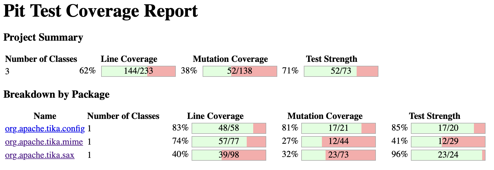
#### Mesure B
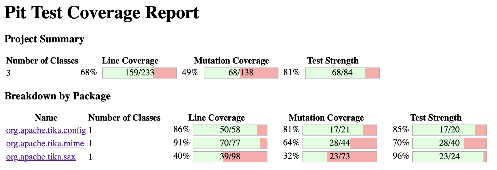
#### Mesure C
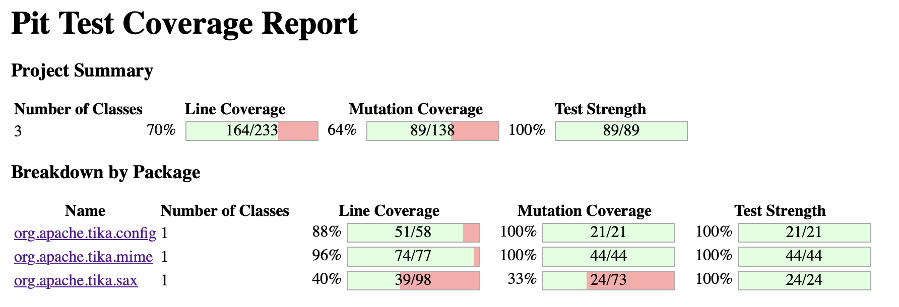

### 3.1 TikaExtras

| Mesure | Tests utilisés | Couverture de lignes | Score de mutation | Force des tests |
|---|---|---|---|---|
| **A** | tests d'origine (`TikaExtrasTest`, 5 tests) | 83 % (48/58) | 81 % (17/21) | 85 % |
| **B** | A + test généré par ChatUniTest (1 test) | 86 % (50/58) | 81 % (17/21) | 85 % |
| **C** | B + 4 tests écrits à la main | 88 % (51/58) | **100 %** (21/21) | **100 %** |

### Mesure B : tests d'origine + test généré
**Les tests générés ne tuent aucun mutant supplémentaire.** La couverture de lignes passe de 83 % à 86 %, mais le score de mutation reste à 81 %. Le seul test retenu (`TikaExtras_extrasDir_3_1_Test`) n'exécute que `extrasDir()`, alors que les 4 mutants vivants sont dans `install()` et `extraJars()` — méthodes jamais atteintes par ce test. Le fichier `TikaExtras_appendJarsToClasspath_2_1_Test` (4 tests, 4 erreurs) a été écarté et n'est pas intégré au projet. Les trois autres fichiers générés ont également été écartés.

### Mesure C
Le score de mutation passe à 100 % (21 mutants sur 21) et la couverture de lignes à 88 %.

---

### 3.2 Patterns

| Mesure | Tests utilisés | Mutants générés | Tués | Score | Force des tests | Couv. lignes |
|---|---|---|---|---|---|---|
| **A** | `PatternsTest` | 44 | 12 | 27 % | 41 % | 74 % (57/77) |
| **B** | A + tests générés corrigés (`Patterns_add_1_0_Test`) | 44 | 12 | 27 % | 41 % | 74 % (57/77) |
| **C** | B + tests manuels (`PatternsManualTest`) | 44 | 44 | **100 %** | **100 %** | **100 %** (77/77) |

#### Mesure A
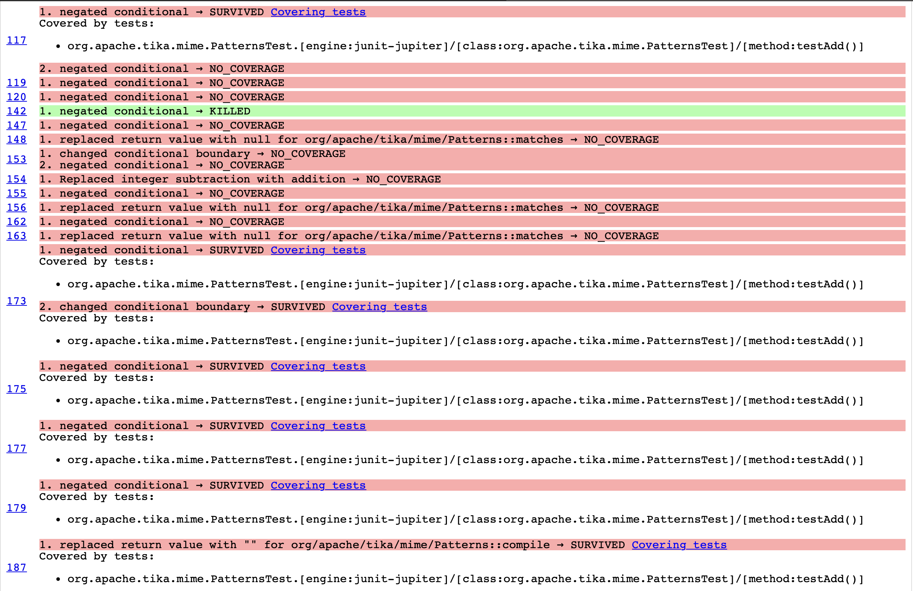
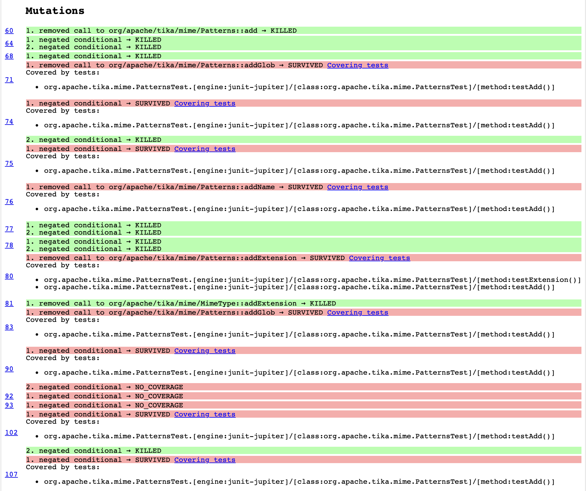

### Mesure B : tests d'origine + tests générés corrigés
**Les tests générés ne tuent aucun mutant supplémentaire.** Le score reste à 27 %. Les tests corrigés vérifient l'état interne des maps par réflexion mais n'appellent jamais `matches()` — les mutations sur le routage et la compilation ne produisent aucun effet observable, et tous les mutants survivants de mesure A restent vivants.

### Mesure C : ajout des tests manuels
Le score de mutation passe à 100 % (44 mutants sur 44) et la couverture de lignes à 100 % (77/77). Les tests manuels appellent `matches(filename)` après `add()` et vérifient le type MIME retourné, ce qui rend toutes les mutations de routage, de stockage et de compilation observables.

| Mutants tués | Raison |
|---|---|
| Lignes 71, 76, 80, 83 (removed call to addGlob/addName/addExtension) | `matches()` retourne null au lieu du type attendu |
| Lignes 74, 75, 90 (negated conditional dans `add()`) | Le pattern est stocké dans la mauvaise map ; `matches()` retourne null |
| Lignes 102, 108 (negated conditional dans `addName()`) | Le type retourné par `matches()` est incorrect |
| Lignes 92, 107, 117, 119 (negated conditional sur `previous == type`) | Logique `isSpecializationOf()` mal consultée ; type retourné incorrect |
| Lignes 173, 175, 177, 179 (negated conditional dans `compile()`) | Le motif compilé ne correspond plus ; `matches()` retourne null |
| Ligne 187 (replaced return with `""` dans `compile()`) | Le motif compilé est vide ; `matches()` retourne null |

---

### 3.3 BasicContentHandlerFactory

| Mesure | Tests utilisés | Mutants générés | Tués | Score | Force des tests | Couv. lignes |
|---|---|---|---|---|---|---|
| **A** | `BasicContentHandlerFactoryTest` | 73 | 23 | 32 % | 96 % | 40 % (39/98) |
| **B** | A + tests générés corrigés (5 fichiers) | 73 | 45 | **62 %** | 78 % | — |
| **C** | B + test manuel (`BasicContentHandlerFactoryManualTest`) | 73 | 46 | **63 %** | 79 % | — |

#### Mesure A
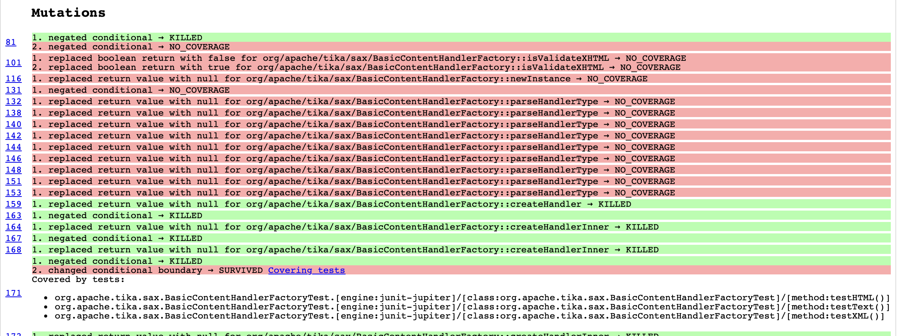

### Mesure B : tests d'origine + tests générés corrigés
Les tests générés tuent **22 mutants supplémentaires** (23 → 45), en couvrant des méthodes entièrement ignorées en mesure A : `equals()`, `hashCode()`, `newInstance()`, `parseHandlerType()`, `handlerTypeName()`, `getType()`, `getWriteLimit()`, `isThrowOnWriteLimitReached()`, `isValidateXHTML()` et le chemin du constructeur 4-arg qui vérifie `throwOnWriteLimitReached == false`. Le score passe de 32 % à 62 %.

| Ligne(s) | Méthode | Mutants tués | Test généré | Raison de la détection |
|---|---|---|---|---|
| 314–321 | `equals()` | 10 (negated conditionals, wrong returns) | `equals_18_1_Test` | le test compare des factories égales et inégales ; toute mutation sur les comparaisons ou les retours produit un résultat inversé, détecté par `assertTrue`/`assertFalse` |
| 131, 132, 151, 153 | `parseHandlerType()` | 4 (negated null-check, null returns) | `parseHandlerType_3_0_Test` | les cas `null`, `"md"` et `"invalid"` sont testés avec des assertions sur le type retourné ; retourner `null` ou court-circuiter la vérification `null` échoue les assertions |
| 116 | `newInstance()` | 1 (null return) | `newInstance_2_0_Test` | le test utilise la factory retournée (`factory.getType()`, `factory.getWriteLimit()`) ; retourner `null` provoque un NPE immédiat |
| 260 | `handlerTypeName()` | 1 (return `""`) | `handlerTypeName_11_2_Test` | `assertEquals("MARKDOWN", factory.handlerTypeName())` détecte tout retour incorrect |
| 255, 280 | `getType()`, `getWriteLimit()` | 2 (null return, return 0) | `hashCode_19_0_Test` | `testGetters` vérifie le type et la writeLimit de la factory construite ; les valeurs mutées échouent les assertions |
| 101, 293 | `isValidateXHTML()`, `isThrowOnWriteLimitReached()` | 2 (wrong boolean) | `hashCode_19_0_Test` | `testGetters` vérifie les booléens ; retourner `true` pour `validateXHTML` (défaut `false`) ou `false` pour `throwOnWriteLimitReached` (défaut `true`) échoue les assertions |
| 191 | `getFormatHandler()` MARKDOWN | 1 (null return) | `newInstance_2_0_Test` | les tests utilisant le type MARKDOWN exercent le chemin vers `getFormatHandler()` ; retourner `null` cause un NPE dans `createHandlerInner()` |
| 81 | constructeur 4-arg | 1 (negated conditional) | `newInstance_2_0_Test` | `newInstance()` appelle le constructeur 4-arg ; la mutation inverse la garde sur `throwOnWriteLimitReached`, déclenchant une `IllegalArgumentException` inattendue |

Cependant, 13 mutants **survivent** (contre 1 en mesure A) : les tests de `hashCode()` ne vérifient que la cohérence (même objet → même résultat), n'importe quelle constante passerait, ce qui laisse 10 mutations vivantes dans cette méthode ; le retour `false` de `isValidateXHTML()` et le retour `true` de `isThrowOnWriteLimitReached()` survivent car les tests n'assertent que l'une des deux valeurs. La frontière `writeLimit < 0` (ligne 171) reste vivante : aucun test n'utilise `writeLimit = 0`.

> **Note sur les métriques.** Le score de mutation (62 %) mesure `mutants tués / total` (45/73). La force des tests (78 %) mesure `mutants tués / mutants couverts` (45/58) — 15 mutants restent sans couverture, tous dans les chemins `createHandler(OutputStream, Charset)` pour les types XML, MARKDOWN et IGNORE, ainsi que dans les cas intermédiaires de `parseHandlerType()` (xml, html, text, body, ignore).

### Mesure C : ajout du test manuel
Le test manuel `testCreateHandlerWithWriteLimitZero` augmente le nombre de mutants tués de 45 à 46. Le score passe de 62 % à 63 %.

| Ligne | Mutant | Test qui le tue | Raison |
|---|---|---|---|
| 171 | changed conditional boundary (`< 0` → `<= 0`) | `testCreateHandlerWithWriteLimitZero` | Avec `writeLimit = 0`, l'original retourne un `WriteOutContentHandler`. Le mutant retourne un handler brut. `assertTrue(handler instanceof WriteOutContentHandler)` échoue avec le mutant. |

**Mutants survivants (12).** Tous se trouvent dans des méthodes maintenant couvertes mais insuffisamment vérifiées :

| Lignes | Méthode | Mutants | Raison de la survie |
|---|---|---|---|
| 329–333 | `hashCode()` (10 mutants) | SURVIVED | `testHashCode` vérifie seulement `h1 == h2` — tout retour constant passe |
| 101 | `isValidateXHTML()` return false | SURVIVED | le test appelle `setValidateXHTML(true)` et vérifie `true`, jamais la valeur par défaut `false` |
| 293 | `isThrowOnWriteLimitReached()` return true | SURVIVED | le test vérifie uniquement le retour de `false`, pas celui de `true` |

**Mutants non couverts (15).** Dans `parseHandlerType()` (cas xml, html, text, body, ignore — lignes 138–148) et dans `createHandler(OutputStream, Charset)` pour les types XML, MARKDOWN et IGNORE (lignes 189, 193, 204, 220, 223, 226, 238, 240, 242). Aucun n'est équivalent ; ils sont simplement dans des chemins non atteints par les tests actuels.

---

## 4. Documentation des tests manuels

### 4.1 TikaExtrasManualTest

### Test 1 : `extraJarsAreSortedByFileName`
**Intention.** Vérifier que `extraJars()` renvoie les jars triés par nom de fichier. Ce tri rend l'ordre de chargement des jars, 
donc la priorité entre les classes qu'ils contiennent, identique d'une machine à l'autre. Sans lui, l'ordre dépendrait de celui 
dans lequel le système de fichiers liste les fichiers.
**Données de test.** Quatre fichiers vides : `B.jar`, `a.jar`, `C.jar` et `d.jar`. Les noms mélangent majuscules et minuscules 
pour une raison précise. Sous Windows, le système de fichiers liste les fichiers sans tenir compte de la casse, ce qui donne 
`a, B, C, d`. Le tri de `TikaExtras` compare les chaînes en tenant compte de la casse. Les deux ordres sont donc différents, et 
supprimer le tri change le résultat. Avec seulement `a.jar` et `b.jar`, les deux ordres seraient identiques et le mutant survivrait. 
J'ai choisi `d.jar` plutôt que `b.jar` parce que Windows ne distingue pas `B.jar` de `b.jar`, ce qui empêcherait de créer les deux fichiers.
**Oracle.** L'ordre attendu est `B.jar, C.jar, a.jar, d.jar`. Il vient de la façon dont Java compare les chaînes : les caractères 
sont comparés par leur code, et les majuscules, de 65 à 90, précèdent les minuscules, de 97 à 122. Le test compare donc la liste 
des noms obtenue à cette liste exacte avec `assertEquals`.
**Mutants visés.** Ligne 122, `removed call to List::sort`, et ligne 122, `replaced return value with ""` pour le comparateur. Dans 
le second cas, toutes les clés de tri deviennent égales, le tri ne change plus rien et l'ordre redevient celui du système de fichiers, 
ce que le test détecte.

### Test 2 : `installUsesThreadContextClassLoaderAsParent`
**Intention.** Vérifier que, lorsque le thread possède un classloader de contexte, `install()` l'utilise comme parent du nouveau 
`URLClassLoader`. Les classes du projet restent ainsi visibles depuis les jars supplémentaires.
**Données de test.** Un `URLClassLoader` vide, créé par le test et défini comme classloader du thread, et un dossier contenant 
un seul jar vide. Le classloader est créé par le test, donc différent de celui de `TikaExtras`. C'est indispensable : dans l'environnement 
de test, le classloader du thread et celui de `TikaExtras` sont probablement le même objet, ce qui explique que le mutant survivait avec 
les tests d'origine.
**Oracle.** Le code de `install()` prend le classloader du thread comme parent, et ne se rabat sur celui de `TikaExtras` que s'il 
est `null`. Le parent du classloader renvoyé doit donc être exactement l'objet défini sur le thread. Le test le vérifie avec `assertSame`, 
qui compare les références et non le contenu.
**Mutant visé.** Ligne 90, `negated conditional` sur `parent == null`. Avec la condition inversée, le classloader du thread serait 
remplacé par celui de `TikaExtras`, et `assertSame` échouerait.

### Test 3 : `installWithNullContextClassLoaderFallsBackToTikaExtrasLoader`
**Intention.** Vérifier le cas inverse : si le thread n'a aucun classloader de contexte, `install()` utilise celui de `TikaExtras` 
comme parent. Cette branche, aux lignes 90 et 91, n'était jamais exécutée.
**Données de test.** Le classloader du thread est mis à `null`, avec un dossier contenant un seul jar vide. Le jar est nécessaire 
parce que `install()` retourne `null` avant d'atteindre cette branche quand il n'y a rien à charger.
**Oracle.** D'après le code, le repli est `TikaExtras.class.getClassLoader()`. Le parent du classloader renvoyé doit donc être cet 
objet, ce que le test vérifie avec `assertSame`.
**Mutant visé.** Ligne 90, `negated conditional`, dans l'autre branche. Avec la condition inversée, le parent resterait `null` et 
le test échouerait. Ce test fait aussi exécuter la ligne 91, jusque-là sans couverture.

### Test 4 : `installRegistersLoaderWithServiceLoader`
**Intention.** Vérifier que `install()` enregistre le nouveau classloader auprès de `ServiceLoader`, la classe que Tika utilise 
pour découvrir ses parsers et ses détecteurs. Le simple fait de le définir sur le thread ne suffit pas, parce que `ServiceLoader` 
garde sa propre référence.
**Données de test.** Un dossier contenant un seul jar vide, ce qui suffit à ce que `install()` crée un classloader. Le test n'a 
besoin d'aucune autre configuration, et il se trouve dans le même package que `ServiceLoader`, ce qui lui donne accès à sa méthode 
`getContextClassLoader()`.
**Oracle.** La documentation de `ServiceLoader` indique que `getContextClassLoader()` renvoie le classloader enregistré, et son 
propre classloader par défaut si aucun n'a été enregistré. Après `install()`, elle doit donc renvoyer exactement le classloader 
que `install()` a retourné, ce que le test vérifie avec `assertSame`. Sans l'appel, elle renverrait le classloader par défaut, 
qui est un autre objet.
**Mutant visé.** Ligne 95, `removed call to ServiceLoader::setContextClassLoader`.

---

### 4.2 PatternsManualTest

### Test 1 : `testAddGlobStoredAndFoundByMatches`
**Intention.** Vérifier que `add()` route un motif glob complexe vers `addGlob` et que `matches()` retrouve le bon type pour un nom de fichier correspondant.
**Données de test.** Un motif `isJavaRegex=true` (`".*\\.log"`) passe directement à `addGlob` sans routage (ligne 71). Un motif avec `?` (`"*.t?t"`) est un glob complexe et atteint `addGlob` via la compilation (ligne 83). Les deux chemins sont testés pour couvrir les deux appels supprimés.
**Oracle.** `matches("app.log")` doit retourner `typeRegex` ; `matches("file.txt")` doit retourner `typeGlob`. Sans l'appel à `addGlob` (mutant lignes 71 ou 83), les deux retournent `null`.
**Mutants visés.** Lignes 71, 83 : `removed call to addGlob`.

### Test 2 : `testExtensionRoutingAndMatches`
**Intention.** Vérifier que `add()` route `"*.txt"` vers `addExtension`, que `matches("document.txt")` retourne le bon type, et que `type.getExtensions()` contient `".txt"`.
**Données de test.** `"*.txt"` est reconnu comme extension simple par `add()` (lignes 74-75). `getExtensions()` n'est peuplé que via `type.addExtension()` (ligne 80), qui n'est appelé que dans la branche extension — pas dans la branche glob. C'est donc un oracle qui distingue les deux chemins de routage.
**Oracle.** `matches("document.txt")` retourne le type ; `type.getExtensions().contains(".txt")` est vrai. Si `addExtension` est supprimé (ligne 80) ou si la condition de routage est inversée (lignes 74, 75), `matches()` retourne `null` et `getExtensions()` est vide.
**Mutants visés.** Lignes 74, 75 (negated conditional), 80 (removed call to `addExtension`).

### Test 3 : `testAddConditionsDoNotThrowAndPreserveEntry`
**Intention.** Vérifier que les conditions de garde dans `add()` et `addName()` / `addExtension()` / `addGlob()` fonctionnent : le premier ajout réussit, et le second ajout d'un type plus spécialisé est un no-op (le type général est conservé).
**Données de test.** `text/plain` et `text/html` sont choisis car `text/html` est une spécialisation de `text/plain` dans le registre par défaut (`getSupertype()` renvoie `text/plain` pour tout `text/*`). Le motif `"*.t?t"` (glob complexe, pas d'entrée dans la map d'extensions) force le passage par la branche glob pour tester la ligne 117. Le nom de fichier `"file.tat"` est clé : il n'a pas d'extension `.tat` enregistrée, donc il passe par la map glob plutôt que la map extensions.
**Oracle.** Après les deux ajouts, `matches("Makefile")`, `matches("file.txt")` et `matches("file.tat")` retournent `typePlain`. Inverser les conditions (lignes 90, 102, 108, 117) force le code à lancer une exception ou à retourner `typeHtml`.
**Mutants visés.** Lignes 90, 102, 108, 117 (negated conditional dans `add()` et ses sous-méthodes).

### Test 4 : `testAddSameObjectTwiceDoesNotThrow`
**Intention.** Vérifier que la condition `previous == type` fonctionne correctement en enregistrant deux fois le même objet `MimeType` : cela doit être un no-op, pas une exception.
**Données de test.** Les mutants sur les lignes 92, 107 et 119 transforment `previous == type` en `previous != type`. Avec deux objets différents, la condition `previous != type` est toujours vraie et le `||` court-circuite, rendant la mutation invisible. Seul un objet identique (`==`) expose le mutant : avec la condition inversée, la branche de levée d'exception est atteinte à tort.
**Oracle.** `patterns.add(pattern, false, type)` appelé deux fois avec le même objet ne doit pas lever d'exception ; `matches()` retourne ensuite le type pour chacun des trois patterns (`"Makefile"`, `"*.log"`, `"*.t?t"`). Avec le mutant, la seconde invocation atteint le `throw` et le test échoue.
**Mutants visés.** Lignes 92, 107, 119 (negated conditional sur `previous == type`).

### Test 5 : `testCompileProducesCorrectRegex`
**Intention.** Vérifier que `compile()` traduit correctement chaque méta-caractère glob en regex Java : `?` → `.` (exactement un caractère), `*` → `.*` (zéro ou plusieurs), `.` → `\.` (point littéral).
**Données de test.** Le motif `"*.t?t"` active les trois règles de traduction. Les cas négatifs `"file.tt"` (zéro char pour `?`), `"file.txxt"` (deux chars) et `"filextxt"` (pas de point) sont choisis pour exposer respectivement une translation incorrecte de `?`, une translation correcte acceptant trop de chars, et l'absence d'échappement du `.`.
**Oracle.** `matches("file.txt")` et `matches("archive.tAt")` retournent le type ; `matches("file.tt")`, `matches("file.txxt")` et `matches("filextxt")` retournent `null`. Si `compile()` retourne `""` (mutant ligne 187) ou si ses conditions sont inversées (lignes 173, 175, 177, 179), les correspondances deviennent incorrectes.
**Mutants visés.** Lignes 173, 175, 177, 179 (negated conditional dans `compile()`), ligne 187 (replaced return with `""`).

---

### 4.3 BasicContentHandlerFactoryManualTest

### Test 1 : `testCreateHandlerWithWriteLimitZero`
**Intention.** Vérifier que `writeLimit = 0` est traité comme une limite active (zéro caractères autorisés), pas comme « illimité », c'est-à-dire que `createHandlerInner()` retourne un `WriteOutContentHandler` et non le handler brut.
**Données de test.** `0` est la valeur exacte à la frontière de la condition `writeLimit < 0`. Le mutant change `<` en `<=`, rendant `writeLimit = 0` équivalent à « illimité ». Seule cette valeur distingue le code original du mutant. Le type `HANDLER_TYPE.TEXT` est choisi car il ne passe pas par le chemin spécial `BODY` (qui enveloppe toujours dans `WriteOutContentHandler` quelle que soit la valeur de `writeLimit`).
**Oracle.** `handler instanceof WriteOutContentHandler` doit être vrai. Avec le mutant (`<= 0`), `writeLimit = 0` satisfait la condition et `createHandlerInner()` retourne le handler brut (`ToTextContentHandler`), donc l'assertion échoue.
**Mutant visé.** Ligne 171 : `changed conditional boundary` (`writeLimit < 0` → `writeLimit <= 0`).

### Test 2 : `testCreateHandlerWithWriteLimitNegativeIsUnlimited`
**Intention.** Vérifier que `writeLimit = -1` est bien la sentinelle « illimité » et que `createHandlerInner()` retourne le handler brut (sans enveloppe `WriteOutContentHandler`).
**Données de test.** `-1` est la valeur canonique « aucune limite » dans l'API. Ce test ancre l'autre côté de la frontière : ensemble avec le test 1, il fixe le comportement attendu en `-1` (retour brut) et en `0` (retour enveloppé), rendant impossible un glissement accidentel de la frontière dans l'un ou l'autre sens.
**Oracle.** `handler instanceof WriteOutContentHandler` doit être faux. Si la frontière était déplacée à `< -1`, ce test le détecterait en retournant un `WriteOutContentHandler` au lieu du handler brut.
**Mutant visé.** Ligne 171 : `changed conditional boundary` (test complémentaire pour ancrer les deux côtés de la frontière `< 0`).

---

## 5. Déclaration de l'utilisation de l'IAG
Déclaration DDIA: Outil d'intelligence artificielle: Claude (Anthropic); 
Conceptualisation: L'IAG a été utilisée pour aider à expliquer les consignes de la Tâche 2 en précisant exactement ce qui est attendu et en expliquant les termes moins clairs. L'IAG a partiellement assistée dans l'écriture des tests manuelles puisque la méthode d'écriture de test n'a pas tout à fait été comprise.; 
Exécution: L'IAG a été utilisée pour aider à l'installation et à l'utilisation d'Ollama et de ChatUniTest puisque leur fonctionnement n'était pas clairs et un peu compliqué par moment. L'IAG a aussi été utilisé lors de l'exécution des tests dans le terminal puisque les commandes n'étaient pas tout à fait connues. L'IAG à également été utilisée pour aider dans le déboggage des tests écrits manuellement. Elle a aussi été utilisée pour aider à écrire dans les fichier pom.xml; 
Rédaction - Révision et édition: L'IAG a été utilisée pour aider à formatter le fichier README.md pour sauver du temps.
