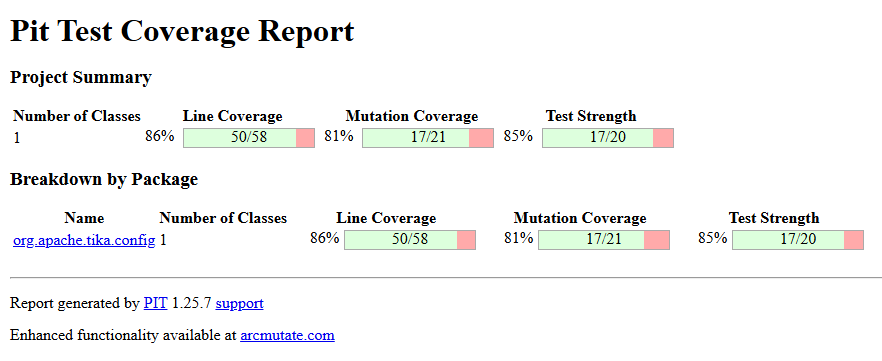
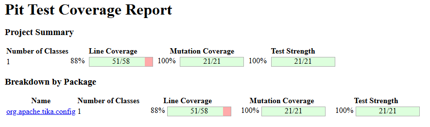

## 1. Choix de la classe

| Élément | Valeur |
|---|---|
| Classe | `org.apache.tika.config.TikaExtras` |
| Test existant | `TikaExtrasTest` (5 tests, tous réussis) |
| Couverture JaCoCo des instructions | 81 % |
| Couverture JaCoCo des branches | 89 % (À COMPLÉTER : vérifier le nombre de branches manquées) |
| Lignes non couvertes (rouge) | 82, 83, 87, 91, 116, 117, 162, 163, 164 |
| Lignes partiellement couvertes (jaune) | 86, 90, 122, 157 |

**Justification** Classe courte, sans dépendance lourde, logique claire (conditions, tri, construction
d'un classpath), avec un test existant mais incomplet.

**Preuve de mutants vivants (mesure A).** Pitest, avec uniquement `TikaExtrasTest` :

| Mutants générés | Tués | Score de mutation | Sans couverture | Force des tests |
|---|---|---|---|---|
| 21 | 17 | 81 % | 1 | 85 % |

Couverture de ligne (classes mutées) : 48/58 (83 %). Rapport archivé : `docs/pit-A/`.

Mutants vivants (4) :

| Ligne | Mutant | Statut | Pourquoi les tests d'origine ne le détectent pas |
|---|---|---|---|
| 90 | negated conditional (`if (parent == null)`) | SURVIVED | le test fournit un classloader déjà non nul, et le classloader de remplacement est le même objet dans l'environnement de test |
| 95 | removed call to `ServiceLoader::setContextClassLoader` | SURVIVED | le test vérifie le classloader du thread, pas celui de `ServiceLoader` |
| 122 | removed call to `List::sort` | SURVIVED | tous les tests utilisent un seul jar, le tri n'a aucun effet visible |
| 122 | replaced return value with `""` pour `lambda$extraJars$0` | NO_COVERAGE | le comparateur n'est appelé qu'avec au moins deux jars |

Remarque : les lignes rouges 82-83, 116-117 et 162-164 (blocs `catch`) comptent pour la couverture JaCoCo mais
ne produisent aucun mutant vivant : Pitest ignore par défaut les appels aux bibliothèques de log.

## 2. Génération des tests

### 2.1 Exécution sans intervention manuelle

Les deux classes de test (sans la Suite) ont été copiées telles quelles dans
`tika-core/src/test/java/org/apache/tika/config/`.

- **Avec checkstyle activé**, le build s'arrête à la phase `validate` : 31 violations lors de la première
  exécution. Lors d'une seconde exécution, sans modification de notre part, il n'en restait que 8, toutes de la
  même règle (imports avec `.*` interdits, 4 par fichier). Hypothèse : Spotless, exécuté par le build de Tika,
  a corrigé automatiquement l'en-tête, l'ordre et les imports inutilisés (À CONFIRMER : `docs/spotless-diff.txt`).
  Les tests ne passent donc pas sans intervention.
- **Avec checkstyle désactivé** (`-Dcheckstyle.skip=true`), les deux fichiers compilent et 5 tests s'exécutent :

| Fichier | Tests | Réussis | Erreurs |
|---|---|---|---|
| `TikaExtras_extrasDir_3_1_Test` | 1 | 1 | 0 |
| `TikaExtras_appendJarsToClasspath_2_1_Test` | 4 | 0 | 4 |

### 2.2 Explication et critique des tests générés

**`TikaExtras_extrasDir_3_1_Test`.** Ce fichier contient un seul test. Il définit la propriété `tika.extras.dir` 
à `"   "` et vérifie avec `assertNull` que `extrasDir()` renvoie `null`.

Le test a de bons côtés. Il vise un cas que `TikaExtrasTest` ne vérifie pas, soit une propriété définie mais blanche, 
à la ligne 157. Son oracle est précis : sans la condition `isBlank()`, `Path.of("")` renverrait un chemin vide au lieu 
de `null`, et le test échouerait. Le nom est explicite et la structure Arrange, Act, Assert se lit facilement.

Il a aussi plusieurs défauts. La propriété système n'est jamais remise dans son état d'origine, ce qui peut perturber 
les autres tests. Le test passe par la réflexion pour construire un objet à constructeur privé, alors que la méthode 
est statique et s'appelle directement. Il utilise `@ExtendWith(MockitoExtension.class)` sans aucun mock, et ses imports 
utilisent la forme `*`, ce que checkstyle refuse. Enfin, il ne teste qu'un cas, et le chemin invalide des lignes 162 à 164 reste sans test.

**`TikaExtras_appendJarsToClasspath_2_1_Test`.** Ce fichier contient quatre tests, tous en erreur. L'intention est raisonnable, puisqu'il 
veut tester l'absence de jar, la présence de jars et une erreur pendant la résolution d'un jar. Le problème est que les tests vérifient des 
mocks et non le code de `TikaExtras` :

- Ils simulent des méthodes statiques du JDK, `Files.isDirectory` et `Files.newDirectoryStream`, sans passer par `mockStatic`, ce qui provoque une `NullPointerException` dès la préparation du test.
- Ils créent un mock de la classe testée, qui n'a que des méthodes statiques. L'instance passée à `invoke` est donc ignorée et le mock ne sert à rien.
- Deux tests répètent ce que `appendJarsToClasspathOffReturnsInput` vérifie déjà dans `TikaExtrasTest`.

### 2.3 Comparaison des oracles

| Critère | Tests originaux (`TikaExtrasTest`) | Tests générés |
|---|---|---|
| Valeurs vérifiées | chaînes exactes (`"base" + sep + abs`), `assertSame` sur l'objet | une valeur (`assertNull`), ou chaînes inventées |
| Données de test | vrais jars créés dans un `@TempDir` | mocks de `Path`, de `Files`, de la classe testée |
| Portabilité | `File.pathSeparator`, fermeture du `URLClassLoader` pour Windows | `/` codé en dur |
| Nettoyage de l'état global | `finally` qui restaure propriété et classloader | aucun |
| Ce qui est testé | le code réel de `TikaExtras` | surtout les mocks eux-mêmes |

## 3. Mutation

| Mesure | Tests utilisés | Couverture de lignes | Score de mutation | Force des tests |
|---|---|---|---|---|
| **A** | tests d'origine (`TikaExtrasTest`, 5 tests) | 83 % (48/58) | 81 % (17/21) | 85 % |
| **B** | A + test généré par ChatUniTest (1 test) | 86 % (50/58) | 81 % (17/21) | 85 % |
| **C** | B + 4 tests écrits à la main | 88 % (51/58) | **100 %** (21/21) | **100 %** |

#### Mesure A

#### Mesure B

#### Mesure C

### Mesure B : tests d'origine + test généré
La couverture de lignes passe de 83% à 86%, mais le score de mutation reste à 81%.
La raison est que ce test n’exécute que extrasDir(), alors que les mutants vivants sont dans install() et extraJars(). 
Autrement dit, le test de l’IA fait exécuter un peu plus de code, mais ne détecte aucun défaut de plus. Les trois autres \
fichiers générés ont été écartés.

### Mesure C
Le score de mutation passe à 100 % (21 mutants sur 21) et la couverture de lignes à 88 %.